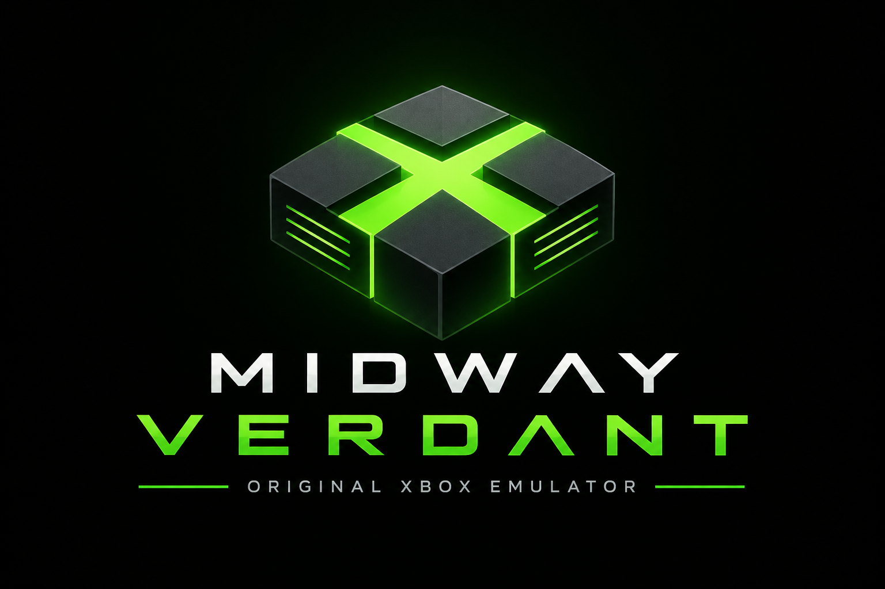

<p align="center"></p>

# Midway Verdant

A clean-room, low-level emulator of the original Xbox for Linux, built to play games at full speed. The console's own boot ROM, BIOS and kernel run unmodified on an emulated machine: MCPX southbridge, NV2A graphics, the APU with its DSPs, IDE storage, USB controllers and the SMBus devices. Nothing in the firmware is patched or replaced with a high-level substitute. The CPU runs under hardware virtualisation (KVM), so the console's Pentium III code executes natively while every device around it is emulated in software.

It ships as a libretro core, `midway_verdant_libretro`, for libretro frontends; [Emutastic for Linux](https://github.com/codingncaffeine/Emutastic-For-Linux) offers it as an optional Xbox core. A standalone SDL3 window is included for development.

**Status:** many retail games boot and play, a good number at their full frame rate on a desktop CPU; others still stall, glitch or sound wrong. The wiki describes every hardware block and keeps the [status page](https://github.com/codingncaffeine/Midway-Verdant/wiki/Status) current.

| Area | State |
|---|---|
| Boot chain | Boot ROM, second-stage loader and kernel run unmodified; the kernel mounts its hard disk and starts a disc or the dashboard. Warm reboot works. |
| CPU | KVM on Linux: the guest's code runs on the host CPU at full speed, with the console's own clock kept from the work it does. A Pentium III interpreter and recompiler serve as the reference for testing. |
| Graphics (NV2A) | Pushbuffer walker, Kelvin state machine, vertex-program and register-combiner translators (including the fixed-function pipeline and the texture-shader modes), texture decoder, 2D engine, video overlay, colour table. A Vulkan renderer with render targets kept on the GPU at up to 6x the internal resolution, on its own thread, shaders compiled in the background, and a persistent shader and pipeline cache. |
| Audio | APU voice processor (PCM, ADPCM, streams, envelopes, filters, multipass voices), two DSP56300 cores running the console's own audio programs, AC'97 output; an optional direct mix that plays every voice straight to stereo. |
| Video | Full-motion video through the video overlay and through game-decoded movies. |
| Input | Two OHCI USB controllers, the front-panel hub and the gamepad (four ports, rumble) from any SDL3 gamepad, the keyboard or a libretro RetroPad. |
| Storage | ATA hard disk with the security lock, a blank retail-layout drive created on demand, ATAPI DVD drive reading XISO and full-dump images on a reader thread. |
| Network | Controller with no cable plugged in; no frames are sent or received. |
| Shells | `midway_verdant_libretro` (the core), `midway-verdant` (SDL3 window and headless runner), and the test tools `mv-pbcap`, `mv-retro-host`, `mv-dsp-bench` and `mv-fatx`. |

Not yet: save states, memory units and the headset, network traffic, and Windows and macOS builds of the core. Compatibility is partial; the wiki's status page says what is open.

## Core options

| Option | Values |
|---|---|
| CPU | fast (hardware virtualization) · accurate (the reference interpreter; not play speed) |
| Audio | console (the console's DSP effects, such as reverb) · direct mix (every voice straight to stereo, no DSP effects) |
| Internal resolution | 1x (native) · 2x · 4x · 6x (the fast CPU; render targets drawn at that many times their size, changed while a game runs) |
| Shader compiling | in the background (no stutter; a new effect can appear a frame late) · in the frame |
| Anisotropic filtering | off (as the game asks) · 2x · 4x · 8x · 16x |
| Disc loading | fast (8x the console's drive) · console speed |
| Run the next frame while the frontend shows this one | enabled (faster, up to a frame more input lag) · disabled |
| Controllers plugged in | 1 to 4 |
| Hard drive | Drive 1 · Drive 2 · Drive 3 |

## Clean room

Midway Verdant is written without leaked or proprietary source material of any kind. Every hardware block is derived from public documentation and datasheets, community reverse-engineering (xboxdevwiki and published papers), public register listings, and observation of the console's own firmware running on the emulated machine. Open-source emulators are read for behaviour only; no code is copied. The wiki's [Clean-Room Methodology](https://github.com/codingncaffeine/Midway-Verdant/wiki/Clean-Room-Methodology) page explains the discipline, and the [Clean-Room Receipts](https://github.com/codingncaffeine/Midway-Verdant/wiki/Clean-Room-Receipts) ledger lists each load-bearing hardware fact with its source and how it was confirmed. A pre-commit scan refuses console dumps, game data and known proprietary hashes, so nothing of the kind can reach the repository.

## What you need

Midway Verdant contains no Microsoft code or data. You supply dumps from your own console:

- the 512-byte MCPX boot ROM
- a flash BIOS image (256 KiB, 512 KiB or 1 MiB)

Both are found by their size, whatever the files are called. On the first start the core generates an EEPROM from the BIOS's own kernel and saves it as `eeprom.bin`, and creates a blank retail-layout hard disk, `xbox_hdd.raw` (sparse: it takes almost no space until the games write to it). A hard-disk image of your own can be used instead: a raw image of 8 GB or more in the same folder (convert a qcow2 one with `qemu-img convert -O raw xbox_hdd.qcow2 xbox_hdd.raw`).

Game discs are read from XISO or full-dump (Redump-layout) images, including FAT32 copies split into `NAME.1.iso`, `NAME.2.iso`, ...

The computer: an x86-64 CPU with hardware virtualisation (Intel VT-x or AMD-V, switched on in the firmware setup), Linux with KVM, and a GPU with a Vulkan 1.1 driver.

## Playing in RetroArch (Linux)

1. **Get the core.** From the [releases page](https://github.com/codingncaffeine/Midway-Verdant/releases), download `midway_verdant_libretro-linux-x86_64.zip`. It holds `midway_verdant_libretro.so` and `midway_verdant_libretro.info`. The core is self-contained: it runs on any distribution with glibc 2.27 or newer (2018 on).
2. **Install it.** In RetroArch, *Main Menu → Load Core → Install or Restore a Core* and pick the `.so`. Then copy the `.info` file into RetroArch's core-info folder (*Settings → Directory → Core Info*) so the core shows its name and firmware list. The usual folders:

   | RetroArch from | Cores | Core info | System (BIOS) |
   |---|---|---|---|
   | your distribution's package, the AUR, or a build of your own | `~/.config/retroarch/cores` | `~/.config/retroarch/cores` or `/usr/share/libretro/info` | `~/.config/retroarch/system` |
   | Flatpak | `~/.var/app/org.libretro.RetroArch/config/retroarch/cores` | the same folder | `~/.var/app/org.libretro.RetroArch/config/retroarch/system` |

   *Settings → Directory* shows the ones your RetroArch actually uses.
3. **Add the firmware.** Make a folder named `midway-verdant` inside the System folder and put the MCPX boot ROM and the BIOS in it.
4. **Use the Vulkan video driver.** *Settings → Drivers → Video* → `vulkan`, then restart RetroArch. The core always draws with Vulkan; with RetroArch on Vulkan too, each frame is handed over on the GPU. Under another video driver it still runs, but every frame is copied back through the CPU, which costs speed at the higher internal resolutions.
5. **Hardware virtualisation (usually nothing to do).** The core runs the console's CPU through the kernel's KVM, which every current distribution opens to all users. If the core says hardware virtualization is off, switch on Intel VT-x or AMD-V (often called SVM on AMD boards, and off by default on many) in your PC's firmware setup. On a system that restricts `/dev/kvm` to a group, the core says so; add yourself to it (`sudo usermod -aG kvm $USER`, then log out and back in). The Flatpak normally has device access already; if not, `flatpak override --user --device=all org.libretro.RetroArch`.
6. **Play.** *Load Content*, pick a disc image, choose *Midway Verdant*. The console's boot animation plays first, then the game. *Quick Menu → Core Options* holds the settings below; the internal resolution changes while the game runs.

The first start of each game compiles its shaders (a stutter or two the first time a scene appears); they are kept in `system/midway-verdant/shader-cache` for the next time.

RetroArch from Steam runs cores inside Steam's own container, which may not pass `/dev/kvm` through: it has not been tested.

### Tested distributions

The release core is booted from a first start (only the MCPX ROM and the BIOS in the folder) in a container of each distribution with KVM and the distribution's own Vulkan loader and software driver (`tools/test-linux-distros.sh`), up to a game's first pictures. Day-to-day play is on Arch Linux with an NVIDIA GPU.

| Distribution | glibc | Result |
|---|---|---|
| Arch Linux | 2.44 | boots and draws |
| Debian 13 (trixie) | 2.41 | boots and draws |
| Fedora 44 | 2.43 | boots and draws |
| openSUSE Tumbleweed | 2.44 | boots and draws |
| Ubuntu 20.04 LTS | 2.31 | boots and draws |
| Ubuntu 24.04 LTS | 2.39 | boots and draws |
| Debian 12 (bookworm), Ubuntu 22.04 LTS | 2.36, 2.35 | the core loads, KVM runs and the console starts, but their software Vulkan driver (llvmpipe built with LLVM 15) stalls drawing; not yet tried with a hardware GPU driver |

Windows: a build with a hypervisor backend (Windows Hypervisor Platform) is in progress. macOS: not yet.

## Building

Linux first: a C++23 compiler (GCC 14+ or Clang 18+), CMake 3.28+, Ninja, SDL3 (from the system or fetched), a Vulkan 1.1 driver, glslang (fetched when the system has none). KVM (`/dev/kvm`) runs the fast mode. Windows builds with MSVC as a secondary platform; it has no hypervisor backend yet, so only the interpreter runs there.

```
cmake -S . -B build -G Ninja -DCMAKE_BUILD_TYPE=Release
cmake --build build
ctest --test-dir build
```

Running, with your own dumps:

```
build/src/midway-verdant --mcpx mcpx.bin --bios flash.bin --hdd disk.img --dvd game.iso --gpu --window
```

`--help` lists every option. `--create-hdd FILE` writes a blank retail-layout drive. The build also produces `midway_verdant_libretro` for libretro frontends.

A release core is built with `tools/build-linux-core.sh` (podman or docker): in the manylinux_2_28 container (glibc 2.28, GCC 14) with `-DMV_PORTABLE=ON`, which builds glslang and the C++ runtime into the core and exports nothing but the libretro API. `tools/test-linux-distros.sh` then boots it in containers of other distributions.

## License

GPL-3.0. See `LICENSE`.
